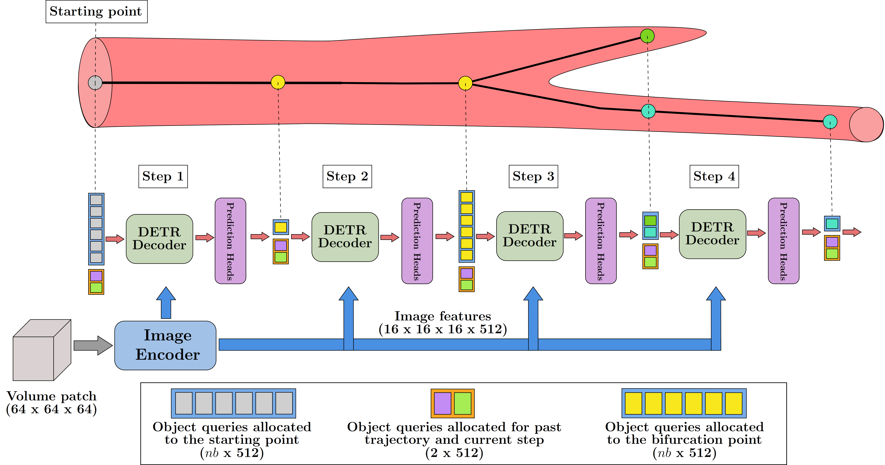

# Trexplorer: Recurrent DETR for Topologically Correct Tree Centerline Tracking

This repository provides the official implementation of the [Trexplorer: Recurrent DETR for Topologically Correct Tree Centerline Tracking]([https://github.com/RomStriker/Trexplorer](https://link.springer.com/chapter/10.1007/978-3-031-72120-5_69)) paper by [Roman Naeem](https://research.chalmers.se/en/person/nroman), [David Hagerman](https://research.chalmers.se/en/person/olzond), [Lennart Svensson](https://research.chalmers.se/person/pale) and [Fredrik Kahl](https://www.chalmers.se/personer/kahlf/). The codebase builds upon [DETR](https://github.com/facebookresearch/detr) and [Trackformer](https://github.com/timmeinhardt/trackformer).

<div align="center">
    
</div>

## Abstract

Tubular structures with tree topology, such as blood vessels, lung airways, and more, are abundant in human anatomy. Tracking these structures with correct topology is crucial for many downstream tasks that help in the early detection of conditions such as vascular and pulmonary diseases. Current methods for centerline tracking suffer from predicting topologically incorrect centerlines and complex model pipelines. To mitigate these issues, we propose Trexplorer, a recurrent DETR-based model that tracks topologically correct centerlines of tubular tree objects in 3D volumes using a simple model pipeline. We demonstrate the model's performance on a publicly available synthetic vessel centerline dataset and show that our model outperforms the state-of-the-art on centerline topology and graph-related metrics, and performs well on detection metrics.

## Installation
1. Clone this repository:
    ```
    git clone https://github.com/RomStriker/Trexplorer.git
    ``` 
2. Install requirements:
    ```
    pip install -r requirements.txt
    ```
3. Install PyTorch 2.2 with CUDA 11.8:
    ```
    pip install torch==2.2.0 torchvision==0.17.0 torchaudio==2.2.0 --index-url https://download.pytorch.org/whl/cu118
    ```

## Training

### Data Preparation
1. Download the [Synthetic Vessel Dataset](https://github.com/giesekow/deepvesselnet/wiki/Datasets/) to `./Trexplorer/data`.
2. Use the provided preprocessing script to convert the data into the required annotation format [[example](https://github.com/RomStriker/Trexplorer/blob/abfb2296743d5c734476865aff732a7abed13936/docs/example_annotation.pickle)] as below:
    ```
    python ./Trexplorer/src/trackformer/datasets/utils/preprocess_synthetic_dataset.py ./Trexplorer/data
    ``` 
4. Running the script above should give you the following data directory structure:
    ```
    Trexplorer
    ├── data
    │   ├── synthetic
    │   │   ├── annots_train
    │   │   ├── annots_val
    │   │   ├── annots_val_sub_vol
    │   │   ├── annots_test 
    │   │   ├── images_train
    │   │   ├── images_val
    │   │   ├── images_val_sub_vol
    │   │   ├── images_test
    │   │   ├── masks_train
    │   │   ├── masks_val
    │   │   ├── masks_val_sub_vol
    │   │   ├── masks_test
    │   │   ├── annots_val_sub_vol.pickle
    ```
   The '_train', '_val', and '_test' directories contain the training, validation, and test images respectively. The '_val_sub_vol' directory contains the validation images that are used for patch-level evaluation. The 'masks' directories contain the binary masks of the vessel trees. The 'annots' directories contain the annotation files in the required format. The 'annots_val_sub_vol.pickle' [[example](https://github.com/RomStriker/Trexplorer/blob/abfb2296743d5c734476865aff732a7abed13936/docs/annots_val_sub_vol.pickle)] file contains the annotations for the validation sub-volume images. 

### Training
The training script uses the configuration file `./configs/train.yaml` to set the hyperparameters. To train the model, run the following command from the root directory:
```
python ./src/train_trx.py
```
For distributed training, use the following command:
```
python -m torch.distributed.launch --nproc_per_node=NUM_GPUS ./src/train_trx.py
```

## Evaluation
For evaluation, in addition to `./configs/train.yaml`, we use  `./configs/eval.yaml`. To evaluate the model, run the following command from the root directory:
```
python ./src/train_trx.py with eval
```
For distributed training, use the following command:
```
python -m torch.distributed.launch --nproc_per_node=NUM_GPUS ./src/train_trx.py with eval
```

## Publication
If you use this software in your research, please cite our publication:

```
@InProceedings{10.1007/978-3-031-72120-5_69,
author="Naeem, Roman
and Hagerman, David
and Svensson, Lennart
and Kahl, Fredrik",
title="Trexplorer: Recurrent DETR for Topologically Correct Tree Centerline Tracking",
booktitle="Medical Image Computing and Computer Assisted Intervention -- MICCAI 2024",
year="2024",
publisher="Springer Nature Switzerland",
address="Cham",
pages="744--754",
abstract="Tubular structures with tree topology such as blood vessels, lung airways, and more are abundant in human anatomy. Tracking these structures with correct topology is crucial for many downstream tasks that help in early detection of conditions such as vascular and pulmonary diseases. Current methods for centerline tracking suffer from predicting topologically incorrect centerlines and complex model pipelines. To mitigate these issues we propose Trexplorer, a recurrent DETR based model that tracks topologically correct centerlines of tubular tree objects in 3D volumes using a simple model pipeline. We demonstrate the model's performance on a publicly available synthetic vessel centerline dataset and show that our model outperforms the state-of-the-art on centerline topology and graph-related metrics, and performs well on detection metrics. The code is available at https://github.com/RomStriker/Trexplorer.",
isbn="978-3-031-72120-5"
}
```
